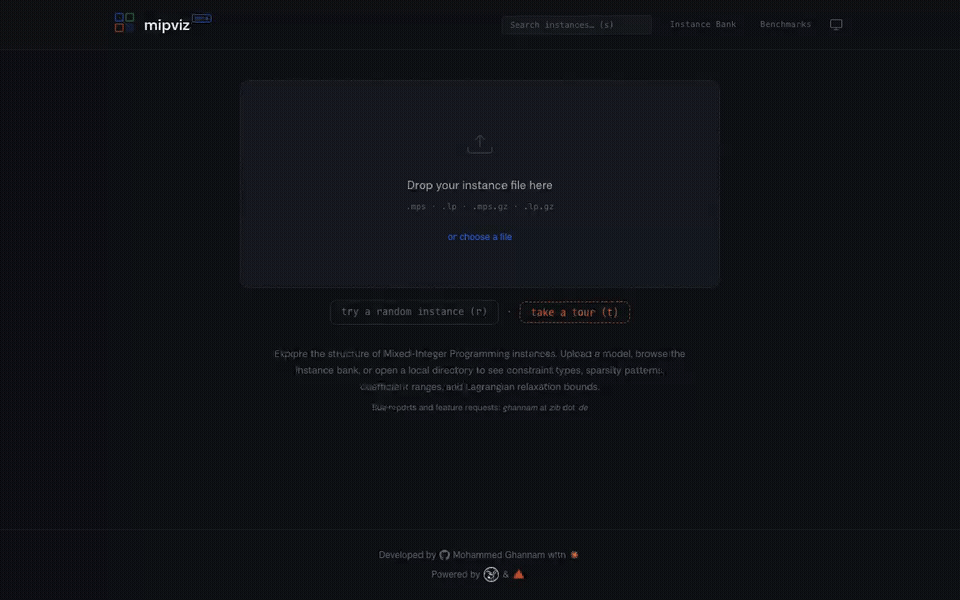

# mipviz

A web tool for exploring the structure of Mixed-Integer Programming (MIP) instances. Everything runs in the browser — SCIP and HiGHS are compiled to WebAssembly. Upload a model or browse the instance library to visualize constraint matrices, inspect presolve results, analyze symmetry, and compare solver performance.

**Live at [mipviz.mghannam.com](https://mipviz.mghannam.com)**



## Features

### Model Viewer
- **Upload & parse** MPS and LP files (including `.gz` compressed)
- **Instance bank** with 1000+ pre-loaded MIPLIB instances
- **Constraint & variable inspection** with LaTeX rendering
- **Coefficient range** analysis (objective, bounds, matrix, RHS)
- **Constraint type classification** across 12 categories

### Matrix Explorer
- **Interactive sparsity pattern** visualization with zoom and minimap
- **Presolve reduction stepping** to see how the matrix changes

### Presolve & Analysis
- **Presolve** via SCIP or HiGHS with original vs presolved comparison
- **Cliques & implications** extraction from presolve
- **Symmetry detection** showing generators, components, and group size (SCIP)
- **LP relaxation** and **MIP solving** with real-time log streaming
- **Lagrangian relaxation** bound plotting for individual constraints

### Conflict Graph
- **Variable conflict visualization** with clique discovery

### Solver Benchmarks
- **Performance comparison** across SCIP, HiGHS, COPT, and Optverse
- **Metrics**: solve time, nodes, presolve size, LP gap to best known solution
- **Per-instance detail pages** with root node bounds and solver logs
- Data from [Mittelmann MILP Benchmarks](https://plato.asu.edu/ftp/milp.html)

## Tech

- **Solvers**: [SCIP](https://www.scipopt.org) and [HiGHS](https://highs.dev), compiled to WebAssembly via Emscripten
- **MPS parsing**: [numnom](https://crates.io/crates/numnom) (pure Rust)
- **Frontend**: Vanilla JS, HTML, CSS — no framework

## Running locally

The repo ships the compiled webassembly code in the 'static' folder, a local version of the website can be run with 
```
cd static && python3 -m http.server 3000
```

## Building

```bash
# Build the WASM module (requires Emscripten SDK)
cd wasm && ./build.sh

# Serve the static files
cd static && python3 -m http.server 3000
```

Then open [http://localhost:3000](http://localhost:3000).

## Terminal preview

An early terminal interface is available for `.mps` and `.mps.gz` models:

```bash
cd terminal
cargo run --release -- ../instances/50v-10.mps.gz
```

Use `1`–`7` (or Tab) to switch between Overview, Variables, Constraints,
the interactive Braille matrix, Presolve, Solve, and Analysis. Press `/` to
search tables, `p` to run presolve, `l` to solve the LP relaxation, or `m` to
solve the MIP with a live log. Use the arrow keys to navigate or pan, `+`/`-`
to zoom the matrix, and `q` to quit. In the Constraints view, press `f` to
filter by the same structural types used on the website or by nonzero count
(`n` opens nonzero editing directly);
name search, type filters, and the nonzero bound combine automatically. Solver
runs use a 60-second preview limit.

The Constraints view uses its full height to show many algebraic constraint
expressions at once, including their coefficients, variables, relations, and
bounds. Press `d` to toggle the complete details for the selected row. On wide
terminals the detail appears beside the table; on narrower terminals it opens as
a compact panel below it.

In the Variables view, press Space to add or remove the selected variable from
the constraint filter. Press `o` to switch between matching ANY or ALL selected
variables. Selected variables are highlighted in blue, and the active variable
filter is shown globally and in the Constraints filter bar. Press `x` to clear
shared variable/component filters.

The Overview and Matrix views report disconnected row/column components. The
matrix is component-ordered and color-coded, and the Presolve view includes the
same matrix and component breakdown for the reduced model. After presolve
finishes, press `a` to load the presolved instance into views `1`–`4`; press `u`
to return those views to the original instance. The active model is shown in the
header.

### Analysis view (`7`)

Press `r` to run a combined HiGHS presolve analysis, then use `1`/`2`/`3` to
switch tabs:

- **Cliques** — extracted from set-packing/partitioning rows (all-binary, unit
  coefficients, RHS `≤ 1` / `= 1`), with sizes and member variables.
- **Implications** — bound implications on binary variables discovered by HiGHS
  presolve.
- **Symmetry** — structural (identical-column) symmetry: interchangeable
  variable groups, generator and component counts, and an estimate of the
  group size.

### Matrix stepper

Press `s` in the Matrix view to run HiGHS presolve in the background and load
the ordered reduction stack, then step through reductions with `[` and `]`
(`0` resets). Hidden rows/columns are removed from the sparsity view, the
current reduction is described in the title, and hovering a cell shows a tooltip
with the constraint × variable coefficient and its LP value once a solution has
been applied. The right-hand panel shows a minimap of the full matrix with a
viewport rectangle.

### Solver parameters

Press `=` in any view to open the parameters editor — one `name = value` per
line (`#` comments allowed). Parameters are applied to HiGHS in-process options
or passed to SCIP as `set` commands on the next presolve/solve/root-cut run.

### Root-node cuts

Press `r` in the Solve view to extract root-node cut statistics from a short
MIP run (or read them automatically from the last solve's log): total cuts,
separation rounds, cuts retained in the LP (HiGHS) or final root LP rows
(SCIP).


In the Variables, Constraints, or Matrix view, press `c` to select a connected
component. That component becomes a shared filter across views `2`–`4`, and
name/type/nonzero filters continue to apply within it. Press `x` to clear the
component filter.

Press `b` to choose the global solver. The selected `HiGHS` or `SCIP` backend is
always shown in the header and controls presolve (`p`), the LP relaxation (`l`),
and MIP solving (`m`). SCIP support uses a native `scip` executable found on
`PATH`; the terminal program still builds and runs when SCIP is not installed.

After an LP or MIP solve completes, press Enter in the Solve view to apply its
primal solution. The Variables view then shows a solution-value column, moves
fractional discrete variables to the top, and highlights them in orange. The
solver and solution type remain visible in the global header.

## License

Apache 2.0
